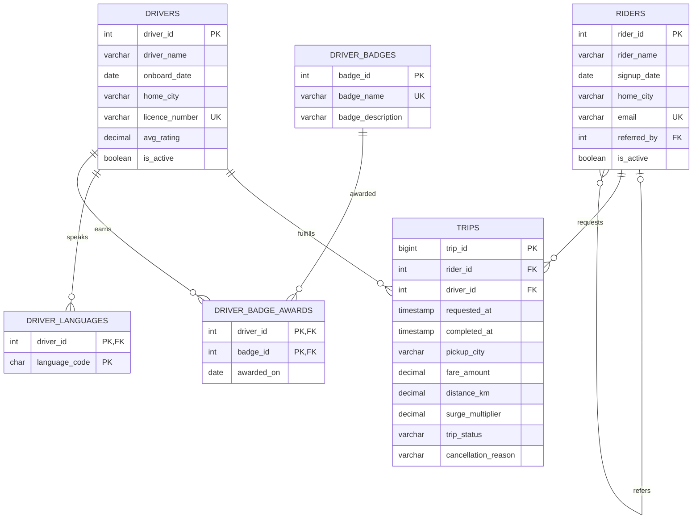

# EX603 Ride Sharing Database

**Name:** Erickson Nguyen  
**Theme:** Ride Sharing

**Project Summary:** A PostgreSQL database that models a ride-sharing platform and supports analysis of trip activity, driver performance, and platform reliability.

## 1. The Domain

This project models a ride-sharing platform that connects riders with drivers to provide transportation services. The database stores information about riders, drivers, trips, driver badges, and badge awards. These records allow the platform to track who is using the service, which drivers are completing trips, and how drivers are recognized for their performance or qualifications.

The platform needs to answer several business questions. How many trips are being completed, cancelled, or disputed? Which drivers are responsible for the highest number of failed trips? Are failure rates improving or getting worse over time? The database also needs to preserve historical trip information and maintain consistent relationships between riders, drivers, and their trips.

The goal of the project is to create a relational database that supports both the operational needs of a ride-sharing platform and the analysis needed to evaluate its performance. The SQL queries turn the stored data into information that can help identify problems and guide decisions.

## 2. Database Overview

The database was designed and implemented using PostgreSQL 14. The original schema definition and table constraints are provided in the Unit 3 DDL file.

### Entity Relationship Diagram




### Tables

The database contains five primary tables:

| Table | Description |
|---|---|
| `riders` | Stores information about people who use the platform to request rides. |
| `drivers` | Stores driver information, including their names, home cities, ratings, and active status. |
| `trips` | Stores trip records and connects riders with drivers. Includes timestamps, pickup locations, fares, distances, surge multipliers, and trip statuses. |
| `badges` | Stores the different types of badges that drivers can earn. |
| `awards` | Connects drivers to the badges they have earned. |

### Key Design Decisions

- `awards` uses `(driver_id, badge_id)` as a composite primary key because it represents the relationship between a driver and a badge.
- `RESTRICT` is used for the `trips` foreign keys to preserve historical trip records.
- `CASCADE` is used for the `awards` foreign keys because award records depend on their referenced driver and badge.
- `CHECK` constraints enforce the specified rules for driver filters, trip duration, and trip fares.
- `trips.pickup_time` is explicitly required using `NOT NULL`.
- The schema uses PostgreSQL-compatible syntax rather than MySQL-specific features.

The `trips` table is especially important to the analysis because it contains the event records used to measure platform activity and failure rates. The `drivers` table provides the driver information needed to group and compare those events. The `badges` and `awards` tables provide additional information about driver recognition.

## 3. Query Catalogue

The SQL queries are organized by course unit. The tables below summarize the purpose of each query and the business question it helps answer.

| Unit | Query | Business Question | SQL File |
|---|---|---|---|
| Unit 3 | Database creation | How should the ride-sharing platform's data be structured and related? | [Unit 3](queries/unit3) |
| Unit 4 | Failure Rate | How well does the platform perform? | [Unit 4](queries/unit4) |
| Unit 5 | Platform Performance | How well does the platform perform? | [Unit 5](queries/unit5) |
| Unit 6 | Performance over time | Is the platform getting better or worse? | [Unit 6](queries/unit6) |

## 4. Technical Highlights

Several SQL techniques were useful in building the database and analyzing the platform's performance.

1. **Joins:** Joins connect related information across tables. For example, joining `trips` with `drivers` makes it possible to analyze trip activity by driver instead of looking at trip records without their associated driver information.

2. **Aggregations and conditional counting:** Functions such as `COUNT()` and conditional aggregation summarize trip activity. Filtering counts to include only cancelled and disputed trips makes it possible to calculate failure rates for the platform and individual drivers.

3. **Common Table Expressions (CTEs):** CTEs break complicated queries into smaller, more understandable steps. The monthly failure-rate query first calculates total and failed events, then uses those results to calculate the failure rate.

4. **Window functions:** Functions such as `LAG()` compare a month's failure rate with the previous month's rate without collapsing the monthly results into a single row. This makes it easier to identify increases and decreases over time.

5. **Constraints and relational integrity:** Primary keys, foreign keys, `CHECK` constraints, and `NOT NULL` constraints help prevent invalid records and maintain consistent relationships between the tables.

## 5. Findings and Recommendations

### Monthly Failure Rates

The monthly analysis showed that the overall failure rate decreased from **28.57% in January to 18.75% in December**, a reduction of **9.82 percentage points**. However, the improvement was not consistent throughout the year. June had the highest monthly failure rate at **40.00%**, with 8 failed events out of 20 total events. April had the lowest rate at **0.00%**, with no failed events out of 11 total events.

This suggests that the platform improved overall during the year, but there were still periods with significant reliability problems. I recommend continuing to monitor monthly failure rates and investigating large increases, especially months like June.

### Driver Failure Rates

The driver-level analysis identified several drivers with notably high failure rates:

| Driver | Total Events | Failed Events | Failure Rate |
|---|---:|---:|---:|
| Driver_03 | 13 | 5 | 38.46% |
| Driver_01 | 11 | 4 | 36.36% |
| Driver_09 | 14 | 5 | 35.71% |

Driver_03 had the highest failure rate, followed by Driver_01 and Driver_09. These results suggest that the platform's failures may not be distributed evenly across drivers. I recommend reviewing the cancelled and disputed trips for these drivers to look for common patterns, such as driver availability, rider cancellations, or other recurring issues. The data identifies where to investigate, but it does not establish the cause of the failures.

### Overall Recommendation

The monthly and driver-level results should be used together. Monthly trends help identify when the platform experiences problems, while driver-level results help narrow down where those problems may be occurring. Continuing both types of reporting would give the team a better way to monitor reliability and decide where further investigation is needed.

## 6. Limitations and Future Improvements

One limitation of this analysis is that it uses a relatively small, fixed dataset covering trips from 2023. The results are useful for demonstrating SQL analysis techniques and identifying patterns within the available records, but they may not represent the platform's current performance or long-term trends. The queries also identify which drivers and months have higher failure rates without explaining why those failures happened. Additional information, such as more detailed cancellation reasons, driver availability, rider activity, and payment outcomes, would help explain the causes. A larger dataset covering multiple years would also make it possible to determine whether the patterns are consistent over time.

## 7. Video Presentation

[Watch the project presentation](YOUR_VIDEO_LINK_HERE)

## 8. How to Run It

The project uses PostgreSQL 14. To run the database, you need PostgreSQL installed and access to the `psql` command-line tool.

### Step 1: Create the database

Open a terminal and create the database:

```bash
createdb rideshare
```

Alternatively, create a database named `rideshare` using your PostgreSQL database management tool.

### Step 2: Create the schema

Run the Unit 3 DDL file to create the tables, relationships, and constraints:

```bash
psql -d rideshare -f path/to/unit3_ddl.sql
```

Replace the file path with the actual location of the DDL file.

### Step 3: Load the data

If the project includes a separate SQL seed or data file, load it after creating the schema:

```bash
psql -d rideshare -f path/to/seed.sql
```

If the DDL file already inserts the data, this step is not necessary.

### Step 4: Execute a query

Run an individual SQL file using:

```bash
psql -d rideshare -f path/to/query.sql
```

To open an interactive PostgreSQL session instead:

```bash
psql -d rideshare
```

You can then execute SQL statements directly or use:

```sql
\i path/to/query.sql
```

**Note:** If your PostgreSQL installation requires a username or password, you may need to provide the `-U` option or configure your connection credentials.

